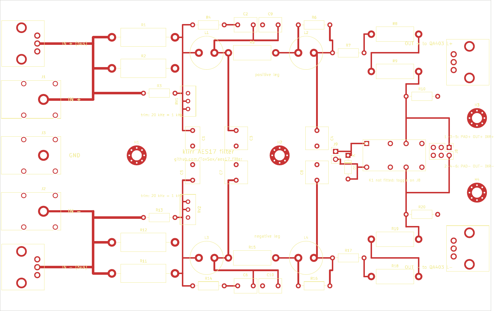

# AES17 class-D measurement filter

A passive low-pass that sits between a class-D amplifier and an audio analyzer, so that the
amplifier's switching residue never reaches the analyzer's input stage. It is the circuit of
the Audio Precision AUX-0025, on a 100 × 158 mm board that slides into a Hammond 1455N1601
case, with the 20 kHz knee trimmable, a 20:1 pad switched by a toggle or a relay, 4 mm safety
sockets and BNC in, BNC out. Designed for a QuantAsylum QA403 and the
[Klirr](https://github.com/ToxSox/klirr) measurement software, usable with anything that has a
100 kΩ input.

**Status: designed, simulated, generated, not yet built.** The Gerbers and the JLCPCB files are
in `hardware/fab/`, the first order has not been placed. Everything below the simulation line
is therefore a claim, not a measurement; the bring-up list in the design review says what will
be measured first.

## Where this comes from

This repository is a fork of Matt Clark's
[aes17_filter_25](https://github.com/mattclarkdotnet/aes17_filter_25) (V2, May 2024), itself a
DIY copy of the AUX-0025, released under the CERN-OHL-W 2.0. The V2 KiCad project, Gerbers,
case cut-outs and dissipation spreadsheet were removed from this tree because they no longer
describe this board; they are intact in the history, tagged **`v2-mattclark`**. The licence
stays the CERN-OHL-W 2.0 (`LICENSE.txt`), and the source location of this derived design is
https://github.com/ToxSox/aes17_filter.

What changed against V2, and why, is argued at length in
[docs/design-review.md](docs/design-review.md). In short:

| | V2 (mattclarkdotnet) | this fork | why |
|---|---|---|---|
| Input resistor | 500 Ω 5 W fixed | AP's network: 1 kΩ 3 W ‖ 14 kΩ ‖ (1 kΩ 3 W + 500 Ω trimmer) | the trimmer sets the 20 kHz knee; V2 sits at +0.10 dB and spreads to 0.21 dB with 5 % coils, trimmed boards land at ±0.03 dB whatever the parts |
| Filter values | E24 approximations (330 Ω + 440 pF, 68 Ω, 3.3 kΩ, 22 Ω) | the AUX-0025's own (412 Ω + 2 × 220 pF, 75 Ω, 3.40 kΩ, 24.9 Ω), all E96 | 1-2 dB more in the stop band, nothing to lose |
| Pad | 9 kΩ / 1 kΩ, two poles per leg, hand-wired toggle | 2 × 10 kΩ / 1 kΩ (about 21.8:1), one pole per leg on a 2 × 3 header, DPDT toggle today, Omron G6A relay footprint for later, pad at rest | the QA403 clips at 40 Vrms and loses 20 dB of floor above its +18 dBV range; 20:1 keeps a 2 kW amplifier below both |
| Connectors | XLR in and out, banana test points | three 4 mm safety sockets and a BNC pair in, a BNC pair out, all through the case's end plates | the analyzer has BNCs; the bench's relay matrix has BNCs |
| Board | 175 × 90 mm, four layers | 100 × 158 mm, four layers, generated from a data file | fits the 1455N1601's rails, spans its length |
| Rating | "140 Vrms continuous" | 85 Vrms at 20 kHz with 5 W parts, as a curve | at 20 kHz the shunt capacitors draw current through the input resistors: 13 W at 140 V |
| Assembly | hand-built | JLCPCB, through-hole parts included, nothing hand-selected | the trimmer absorbs the tolerances |

## What is in the tree

| Path | What |
|---|---|
| [docs/design-review.md](docs/design-review.md) | the review of the V2 design against the AUX-0025 and the QA403, the simulation, the pad decision, the build decisions, the bill of materials, bring-up |
| [docs/sourcing.md](docs/sourcing.md) | the shopping list with hard specifications, substitutes and open questions |
| [sim/aes17_sim.py](sim/aes17_sim.py) | the AC analysis that produced every number in the review (numpy only) |
| [hardware/](hardware/) | `design.py` (parts and nets as data), `make_pcb.py` (places, routes and checks the board with KiCad's `pcbnew`), `export.py` (Gerbers, BOM, placement), the schematic, the end-plate drilling, and [hardware/README.md](hardware/README.md) with the ordering steps |
| [hardware/fab/](hardware/fab/) | `aes17-filter-gerbers.zip`, `aes17-filter-bom.csv`, `aes17-filter-cpl.csv` for JLCPCB; `aes17-filter-parts.csv` with notes |

## Simulated performance

One leg against ground, 100 kΩ load, relative to 1 kHz; the script prints the full tables.

| | V2 as published | this fork, trimmed |
|---|---|---|
| Passband 20 Hz - 20 kHz | −0.00 / +0.10 dB nominal, up to 0.21 dB spread with ±5 % coils | within ±0.03 dB after trimming, whatever the coils and capacitors |
| −3 dB | 58 kHz | 58 kHz |
| 250 kHz | −53.6 dB | −52.5 dB (two 220 pF instead of 390 pF) |
| 500 kHz | −57.5 dB | −58.4 dB |
| 1 MHz | −69 dB | −70 dB |
| Insertion loss | −0.05 dB | −0.05 dB |
| Source noise at the analyzer | −124 dBV direct | −124 dBV direct, −122 dBV through the pad |
| Input resistor at 63 Vrms, 20 kHz | 2.7 W | 1.4 W in each of two |

A real box will land a few decibels short of the stop-band figures: one V1 build measured 45 dB
at 248 kHz against 55 simulated, and the 1 mH coils' self-resonance (1.3 MHz) takes 10-20 dB off
above 2 MHz, where the filter is 80 dB down anyway.

## Ordering and building

[hardware/README.md](hardware/README.md): upload the three files in `hardware/fab/` to JLCPCB,
five boards, two assembled, Economic. Every BOM line has an LCSC number; five lines are
pre-order parts (the Würth coils, both WIMA capacitors, the Cliff sockets), and the Cliff sockets
are cheaper bought at Digi-Key and soldered by hand. Not on the board: four BNC jam nuts, a DPDT
toggle, the Hammond case, two BNC leads. Then drill the end plates after
`hardware/aes17-filter-endplates.png`, trim both legs through an amplifier until 20 kHz equals
1 kHz, measure the pad ratio, and the filter is a probe profile in Klirr.

## Licence

CERN Open Hardware Licence Version 2 - Weakly Reciprocal, as the original. Copyright of the
original design Matt Clark 2023-2024; the changes described above and in the design review were
made in November 2026 in this repository. If you build or change it, the licence asks that you
keep these notices and make your changes available under the same terms.
