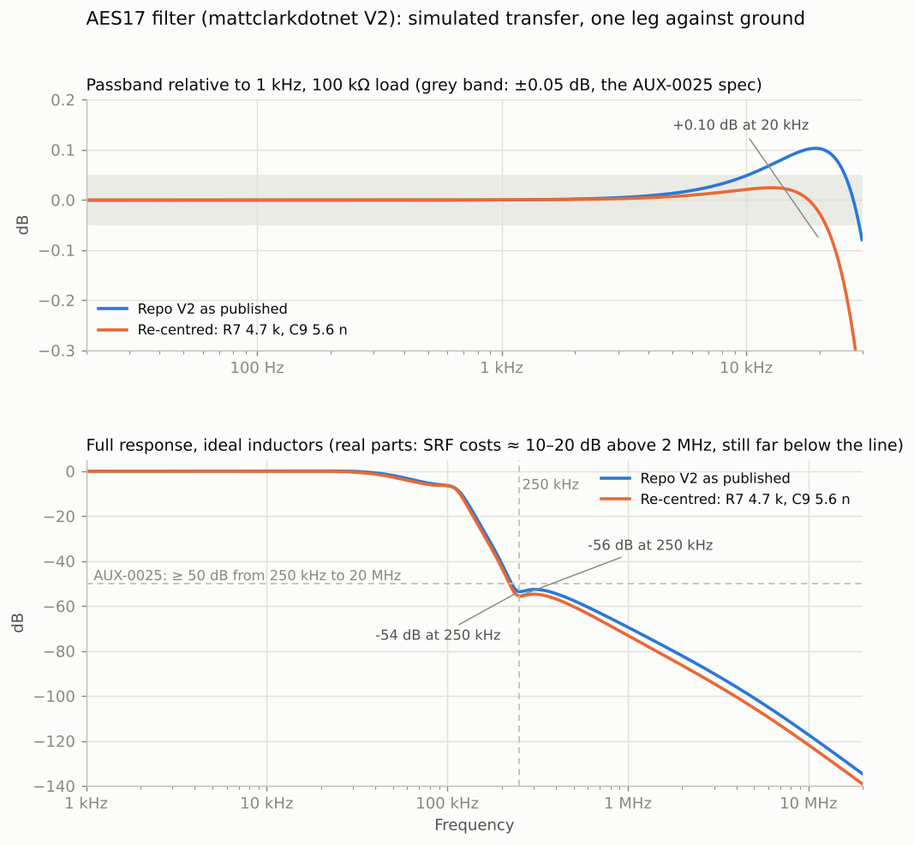

# The AES17 filter

A passive low-pass between a class-D amplifier and the QA403, so that the amplifier's switching
residue never reaches the analyzer's input stage. Audio Precision sells this as the AUX-0025;
Matt Clark's [aes17_filter_25](https://github.com/mattclarkdotnet/aes17_filter_25) (V2, May
2024, CERN-OHL-W) is a DIY copy of it, and this repository is a fork of it. This document reviews
that design against what a bench with a QuantAsylum QA403 and the [Klirr](https://github.com/ToxSox/klirr)
measurement software needs, with the numbers to argue with, and says what this fork changes. It was
written before anything was ordered; the status of the build is in the [README](../README.md).

Decided: **single-channel boards**, two built from the five-board minimum order. **Input on 4 mm
safety sockets with a BNC pair in parallel; output on a BNC pair** straight into the QA403.
**The topology and the impedance level stay as they are** - the design is a faithful copy of the
AUX-0025 and nothing found below beats it for the money. What changes: the **20 kHz knee gets a
trim**, the **pad becomes 20:1**, switched by a toggle today and a relay once the matrix drives
it, the **inductors are
measured and paired**, and the **voltage rating is stated honestly** as a curve rather than a
number. The reasoning follows.

## What the filter is for, on a QA403

The QA403's own anti-aliasing is good: its product sheet shows a 0 dBV tone at 346 kHz
suppressed by more than 120 dB at its alias, and QuantAsylum themselves say they have not met a
class-D amplifier that needed a pre-filter. So the filter does not exist to keep the carrier out
of the FFT. It exists for three other reasons:

- **The input stage.** A modern module leaves 0.25-0.35 Vrms of residual at 400-620 kHz on the
  speaker terminals (Purifi quotes 0.25 Vrms for the 1ET9040BA; a Hypex NC252MP was measured at
  340 mV; an 80 kHz output filter raises that to about 2 Vrms). Through a 20:1 pad that is still
  10-100 mV of fast edges into a buffer that was designed for audio. AP's reason for the AUX
  family is exactly this: slew-induced distortion in the analyzer's front end, which shows up as
  IMD that is not the amplifier's.
- **Ranging.** Klirr auto-ranges on the peak it sees. A carrier riding on the signal costs
  headroom and, in the worst case, clips a range the audio alone would have fitted.
- **DC and relay cycling.** A single-supply module idles at half its rail. The QA403's input is
  AC-coupled below 1 Hz, so the step at power-on walks through the ranges and QuantAsylum's forum
  has a thread on the attenuator relay cycling on it. The filter does not fix that, but it is
  where the 20 kHz residue of the step is absorbed instead of the analyzer.

What the filter will **not** do is lower the noise floor of a measurement. The QA403's 20 kHz
bandwidth already ends where the filter starts. Any "more signal-to-noise" has to come from where
the signal sits in the analyzer's ranges, which is the pad's job, below.

## What the repo design is

The repository's XML netlist export is stale (it is V1, with Zener clamps at the output that were
removed in October 2023 because they cost 5 dB of noise). The real V2 circuit is in the PCB file,
and per leg against ground it reads:

```
amp  ──[ R1 500 Ω 3-5 W ]──┬──[ L1 1 mH ]──────────┬──[ R5 68 Ω ]──┬──[ L3 1 mH ]──┬──[ R9 22 Ω ]──┬── out
                           │   ╰─[ R3 330 ]─[ C 440 p ]─╯             │   ╰─[ R7 3.3 k ]─╯            │
                        C1 220 p                   C7 4.7 n          │                C9 4.7 n     pad 9 k / 1 k
                           │                        │                 │                   │            │
                          GND                      GND               GND                 GND          GND
```

Both legs are identical, every shunt capacitor goes to ground (so the stop band applies to
common-mode as well as differential signals), the two legs meet only at the XLR shells, and a
switchable 9 kΩ / 1 kΩ pad sits after the 22 Ω. It is a transcription of the AUX-0025 into
E-series values. The AUX-0025's circuit was traced and published in 2015 (Cranial Crumbs, "Audio
Precision's class D filter"; AP's own 2003 white paper confirms the topology and the "500 Ω in
series with 10 nF per side" input model):

| Position | AUX-0025 (traced) | aes17_filter_25 V2 | Note |
|---|---|---|---|
| Series input | 1.0 k 3 W ‖ 14.0 k ‖ (1.0 k 3 W + 200 Ω trimpot) ≈ 467-520 Ω | 500 Ω 3-5 W fixed | **the trim is the 20 kHz knee adjustment** |
| First shunt | 220 pF 400 V | 220 pF 250 V | |
| First inductor + bypass | 1 mH, 412 Ω + 390 pF 630 V across it | 1 mH, 330 Ω + 440 pF across it | |
| Second shunt | 4700 pF 630 V | 4.7 nF 250 V | |
| Series between stages | 75.0 Ω | 68 Ω | |
| Second inductor + damping | 1 mH, 3.40 k across it | 1 mH, 3.3 k across it | |
| Third shunt | 4700 pF 630 V | 4.7 nF 250 V | |
| Series output | 24.9 Ω | 22 Ω | |
| Inductors | 28 AWG on a PQ2625 bobbin, **no core** (air) | Würth 7687480102 (WE-TI HV) ferrite drum core, ±5 %, 1.0 Ω, SRF 1.3 MHz | the one real difference |
| Pad | none | 9 k / 1 k after the output resistor, switchable | |

So "is the design state of the art" has a short answer: it *is* the state of the art, because it
is the AUX-0025, and AP has not changed that circuit since 2003. There is no newer topology in
the DIY world to move to. Every published alternative (the Clockworks matched-impedance filter
of 2018, Redako's compact board of 2025, the "Audioidiot" air-core build on ASR in 2026, E1DA's
gentler LC board) is either the same circuit with different parts or a worse trade.

## Simulated behaviour

The numbers below are from a nodal AC analysis of one leg against ground
([sim/aes17_sim.py](../sim/aes17_sim.py); it needs only numpy and prints every table in this
section). It reproduces the repo's published curve, which is the check that the
netlist above is right.



**Passband.** Into 100 kΩ, relative to 1 kHz, the V2 values peak by **+0.10 dB at 20 kHz**; the
repo quotes this as "±0.05 dB" by centring it. The AUX-0025 values give +0.075 dB; with the
analyzer's 100 kΩ and about 185 pF of input plus cable it is +0.05 dB, and AP then trims each leg
to flat with the pot. The −3 dB point is 58 kHz. Load dependence is only insertion loss:
−0.05 dB into 100 kΩ, −0.1 into 50 kΩ, −0.5 into 10 kΩ, with the same shape.

**Stop band.** −53.6 dB at 250 kHz, a shelf at −52 to −58 dB through 500 kHz (the bypass
resistor across each inductor sets it), −69 dB at 1 MHz, then falling 12 dB per octave. The
AUX-0025 values are within 1-2 dB of this everywhere. One V1 build measured only 45 dB at
248 kHz on an HP 3585A; parasitics and layout eat something, so expect 45-50 dB in a real box.

**What does not matter.** Magnetic coupling between the two inductors of one leg changes the
stop band by under 2 dB even at k = 3 % (they are in series, so the coupled path mostly adds to
the wanted one); coupling is linear and cannot by itself add distortion, only move the curve. The Würth part's self-resonance (parallel capacitance of 15-30 pF) costs 10-20
dB only above 2 MHz, where the filter is already 80 dB down. DCR between 0.3 and 3 Ω moves the
20 kHz figure by 0.02 dB. So the V2 author's "space the inductors out" is harmless but was not
what fixed his HD3 problem; see the ASR section.

**What does matter: tolerances.** 400-sample Monte Carlo on the passband, all parts at the
edges of their stated tolerance, 100 kΩ load:

| Parts | Passband spread 20 Hz-20 kHz, worst / 95 % | 20 kHz relative to 1 kHz | Worst rejection 250-500 kHz |
|---|---|---|---|
| L ±5 %, C ±2.5 %, R ±1 % (repo BOM) | 0.21 / 0.17 dB | +0.01 to +0.21 dB | 51.4 dB |
| L ±10 %, C ±2.5 % (shielded-inductor option) | 0.28 / 0.22 dB | −0.06 to +0.28 dB | 50.7 dB |
| L ±2 %, C ±1 % | 0.16 / 0.14 dB | +0.05 to +0.16 dB | 52.1 dB |

Tighter parts alone do not reach the AUX-0025's ±0.05 dB, because the nominal already sits at
+0.10. What does reach it is **R1 as a trim**: between 487 and 520 Ω the 20 kHz figure swings
from +0.15 to −0.06 dB, with nothing else moving (250 kHz changes by 0.1 dB). That is why AP has
a pot there, and it is the single change that makes a DIY board as flat as the original.
Alternatively a fixed re-centring - R7 4.7 k and C9 5.6 n instead of 3.3 k and 4.7 n - halves
the spread (−0.03 / +0.02 dB nominal) and adds 2 dB at 250 kHz, but it cannot follow the
inductors you actually received; the trim can.

**Leg matching.** With two independently toleranced legs, a common-mode input converts to
differential at −29 dB at 20 kHz and −19 dB at 100 kHz (5 % / 2.5 % parts), improving to −38 /
−28 dB with 2 % / 1 % parts. Bridged amplifiers put little common mode in the audio band, and
above 250 kHz the conversion is better than −60 dB, so this is not a measurement problem; it is
the reason to measure the four inductors and put the two closest into one board.

**Dissipation, and the honest voltage rating.** The shunt capacitors draw current at the top
of the band, and all of it flows through R1:

| At the amplifier | 1 kHz | 20 kHz | Output shorted, 1 kHz |
|---|---|---|---|
| 45 V (500 W / 4 Ω) | 0.00 W in R1 | **1.4 W in R1**, 52 mA in L1 | 2.9 W |
| 63 V (1000 W / 4 Ω) | 0.01 W | **2.7 W**, 73 mA | 5.7 W |
| 89 V (2000 W / 4 Ω) | 0.01 W | **5.4 W**, 103 mA | 11.4 W |
| 140 V (repo's "max") | 0.04 W | **13.3 W**, 161 mA | 27.9 W |

The repo's silkscreen says "140 Vrms continuous into >10 k load". That is true at 1 kHz and
false at 20 kHz, where a 5 W resistor is at 2.5 times its rating. AP rates the AUX-0025 as
140 Vrms "DC to 7.5 kHz, decreasing to 53 Vrms from 20 kHz to 2 MHz" for exactly this reason,
and puts two 3 W resistors in parallel per leg. For this bench the rule is: **a 20 kHz sweep at
rated power is fine up to about 85 V (1800 W into 4 Ω) with 5 W parts, and the probe's
`MaxInputVoltage` should say 85 V**, not 140. Klirr's THD+N-versus-frequency curve runs at the
reference power, not the rating, so the hot case is only the 20 kHz point of a full-power
response sweep.

**Noise.** The source resistance the analyzer sees is 590 Ω per leg, 1.2 kΩ differential:
0.63 µV in 20 kHz, −124 dBV, six dB under the QA403's best floor. With a 20:1 pad behind it the
output impedance is about 950 Ω per leg, −122 dBV. The filter is not where the noise is.

## What the ASR builders found

The design thread ("DIY amp testing (with AES17 filter)", ASR, 2023-2026, 8 pages) is worth
the read; the conclusions that bind this build:

- **The shunt capacitors must go to ground**, not to a floating midpoint between the legs. V1
  started floating; IVX (E1DA) pointed out that a floating LC rejects no common mode at all, and
  the ground ties were added in August 2023. Done in V2, keep it.
- **The +6 dB HD3 penalty** that sarieri measured on a V1 board at 5 V (−127 to −133 dB against
  −137 dB through E1DA's filter) went away on V2 (−133 dB and better). The V2 author credits the
  spacing; the simulation says spacing cannot do that, and sarieri's own breadboard of the same
  circuit had no penalty, so the likelier cause is **what the V1 layout coupled into the
  ferrite cores and traces** (the XLRs and the high-current input run were next to the coils).
  Either way: keep inductors away from the input run and the connectors, and remember that these
  figures are 15-20 dB below anything a QA403 can resolve. For this bench the ferrite-versus-air
  question is settled by hum, not distortion: Clockworks measured 60 Hz pickup in air-core coils
  change three-fold with orientation even inside a steel box, and this bench has a 1 kW load
  bank and a lab supply within a metre. **Ferrite drum cores, measured and paired.**
- **Source impedance is everything.** The author's 0.5-0.7 dB droop at 20 kHz turned out to be
  the 88 Ω output impedance of the DAC he tested with. An amplifier (< 1 Ω) is what the filter is
  designed around, and AP specifies < 2 Ω. **This also means the QA403's own generator cannot be
  used to trim the filter directly**: its output is 100 Ω single-ended and 200 Ω balanced (product
  sheet), which adds to R1 and would set the knee for a source that no amplifier has. Trim
  through an amplifier.
- **Load impedance** below about 10 kΩ bends the response (50 Ω gives a 12 dB peak at 30 kHz).
  The QA403's 100 kΩ per BNC is fine; the bench's existing 5 kΩ L-pad behind the filter would cost
  1 dB of insertion loss and must be re-measured with the filter in place if it is ever used
  that way.
- **The pad belongs after the filter**, as low in impedance as dissipation allows, and
  bypassable. A pad in front wrecks the response; the author and the thread tried three
  variants and came back to this.
- **No clamp diodes** at the output. They cost 5 dB of noise floor in the V1 build.
- **All-metal case, bonded**, pin-1/shell to the ground pour at one point, and a dedicated
  ground post "reserved for solving hum". Bare-board measurements were position-sensitive;
  boxed ones were not.

## The pad

The QA403's input is the constraint, and its product sheet is specific:

| QA403 fact | Value |
|---|---|
| Full-scale ranges | 0, +6, +12, +18, +24, +30, +36, +42 dBV |
| Attenuator | a relay engages for +24 dBV and above and raises the noise floor by about 20 dB |
| Maximum input | **+32 dBV = 40 Vrms**, software-clipped even on the +42 dBV range; absolute maximum 56 Vpk including DC |
| Input impedance | 100 kΩ per BNC to Audio Common, AC-coupled below 1 Hz; about 100 pF (user-measured, not specified) |
| Noise floor per range, 20 kHz, inputs shorted (Cordell's measurements, not a QuantAsylum spec) | 0 dBV: −118; +6: −114; +12: −110; +18: −104; **+24: −83; +30: −83; +36: −81; +42: −79 dBV** |

Two things follow. **Nothing above 40 Vrms may reach the BNCs** - the "+42 dBV" range name
suggests 126 Vrms and that is not what the input takes; Klirr's own bench notes had that wrong and
its direct probe profile still allows 42 Vrms, which is over the absolute maximum (42 Vrms of sine
is 59 Vpk). And the sweet spot is narrow: a signal should
sit in the **+18 dBV range or below**, because the step to +24 costs 20 dB of floor at once,
while below +18 the floor falls only 4-6 dB per range, so the dynamic range relative to full
scale barely changes (118 dB at 0 dBV, 122 dB at +18).

Put the bench's operating points through that, with the signal placed in the lowest range that
holds it with 1 dB of headroom:

| Operating point | At the amplifier | Direct | 3.42:1 (bench pad, down) | 4.85:1 (bench pad, up) | 10.6:1 (repo) | 20:1 |
|---|---|---|---|---|---|---|
| 5 W into 4 Ω | 4.47 V | +18 range, **117 dB** | +6, 116 dB | +6, 113 dB | 0, 111 dB | 0, 105 dB |
| 5 W into 2 Ω | 3.16 V | +12 range, **120 dB** | +6, 113 dB | 0, 114 dB | 0, 107 dB | 0, 102 dB |
| 100 W into 4 Ω | 20 V | +30, 109 dB | +18, **119 dB** | +18, 116 dB | +12, 116 dB | +6, 114 dB |
| 500 W into 4 Ω | 44.7 V | **over 40 Vrms** | +24, 105 dB | +24, 102 dB | +18, **117 dB** | +12, **117 dB** |
| 1000 W into 4 Ω | 63.2 V | over 40 Vrms | +30, 108 dB | +24, 105 dB | +18, **120 dB** | +12, **120 dB** |
| 2000 W into 4 Ω | 89.4 V | over 40 Vrms | +30, 111 dB | +30, 108 dB | +24, 102 dB | +18, **117 dB** |

(The dB figure is the analyzer's noise floor below the signal - the ceiling any SNR or THD+N
reading can reach, before the amplifier adds anything.)

So the intuition behind "the repo's pad is more than I need, and without one I'd have more
voltage at the analyzer, which may be no bad thing" is **right for the audio block and wrong
for the power sweeps**. Direct is the best possible connection at 5 W, by 4-7 dB over the
present L-pad. But 500 W and up cannot be measured direct at all, and through the present
4.85:1 they land in the attenuator ranges, 12-15 dB worse than through 10:1 or 20:1. The
present pad is a compromise that is optimal nowhere. A lower pad than the repo's would make the
power sweeps worse, not better.

**Decision: two positions, direct and 20:1, on the filter board.** 20:1 rather than the repo's
10:1 because it keeps a 2 kW / 4 Ω amplifier in the +18 range and gives up nothing at 500 W
or 1 kW; 20:1 is also what the bench's planned relay matrix had on its bus, so the filter's pad
*is* the matrix's divider and there is one divider on the bench, not two. Values: 2 × 9.53 kΩ in
series and 1.00 kΩ to ground, 0.1 %, 0.5 W, per leg - the ratio including the filter's 590 Ω
and the analyzer's 100 kΩ is about 20.8:1, and Klirr measures it anyway. Loading on the filter
is 20 kΩ, 0.25 dB of insertion loss that the measured ratio absorbs. At 140 V the 19 kΩ
dissipates 1 W; at 63 V, 0.2 W.

The switch is a **DPDT toggle in the end plate, wired to a 2 × 3 header on the board** - the
original's arrangement - with the footprint of a DPDT signal relay (Omron G6A-274P) sitting on
the same six nets, **unpopulated**. A toggle because today nothing exists to
drive a relay: the QA403 cannot (its front expansion connector carries I2S and I2C for digital
accessories and a 3.2 V supply good for 20 mA, no switchable lines, and QuantAsylum documents
no software control of those pins), and a relay switched by a toggle through a wall adapter is
a toggle with extra steps. When the matrix controller exists, the relay is soldered in, the
toggle's wires come off the header, and the position is set by Klirr before every step; until
then the two positions are two probe profiles in Klirr, named by what the operator sees, and its
gain check between steps catches a switch that did not move.

One pole per leg is enough: the pad hangs on the filter output permanently (20 kΩ, a quarter
of a decibel that the measured ratio absorbs) and the switch only chooses whether the BNC sees
the filter output or the 1 kΩ tap. So the whole board needs one DPDT - one pole for each leg -
and the header carries exactly that. KiCad numbers a 2 × 3 header across the rows, so the pins
1-3-5 are one row of three and 2-4-6 the other, which is the lug layout of a DPDT toggle, common
in the middle:

| Header pin | Row | Net | Toggle lug |
|---|---|---|---|
| 1 | + leg | pad tap, + leg | pole A, "pad" |
| 3 | + leg | **output BNC +** | pole A, common |
| 5 | + leg | filter output, + leg (direct) | pole A, "direct" |
| 2 | − leg | pad tap, − leg | pole B, "pad" |
| 4 | − leg | **output BNC −** | pole B, common |
| 6 | − leg | filter output, − leg (direct) | pole B, "direct" |

The relay footprint sits on the same six nets: pins 4 and 13 (the commons) on the BNCs, 6 and
11 (normally closed) on the pad taps, 8 and 9 (normally open) on the filter outputs. **At rest
the relay selects the pad**: with the matrix controller off or unplugged the analyzer sees a
twentieth of the amplifier, which is the safe default. The repo's header is laid out
differently (two poles per leg, and its second pole's common on pin 6 with the two "direct" pins
on 3 and 4), so a toggle wired pin for pin to that board leaves the output open in one position;
worth knowing for anyone who builds the repo's board as is.

With that, the bench's L-pad is retired. The 5 W block runs direct through the filter, every
power sweep above about 35 Vrms runs through 20:1, and Klirr's per-step probe choice becomes the
thing to build on the software side.

## The build

**Circuit:** the AUX-0025 values rather than the repo's E24 approximations, since every one of
them exists in E96: 412 Ω, 390 pF, 75.0 Ω, 3.40 kΩ, 24.9 Ω. They sit 1-2 dB better in the shelf
and 0.03 dB flatter at 20 kHz. The input network as AP has it, with a wider pot: **1.00 kΩ 3 W ‖
14.0 kΩ ‖ (1.00 kΩ 3 W + 500 Ω multi-turn trimmer)**, which spans 483-575 Ω. AP's 200 Ω pot
spans 483-525 Ω and is enough for AP's own 2.5 % parts; with 5 % inductors and 5 % capacitors
straight from the reel, the Monte Carlo below needs 494-532 Ω, and with 10 % inductors
480-542 Ω, so the 500 Ω pot covers every case with room. The network spreads 6 W of rating over
two resistors, and the trimmer carries at most half the current (0.25 W at 63 V and 20 kHz; a
Bourns 3296W is rated 0.5 W).

**Capacitors:** polypropylene (WIMA FKP2 or Kemet PFR, 5 mm pitch, the same footprint), 630 V
for the 220 pF and 390 pF, 250 V or better for the 4.7 nF. ±5 % is good enough, because the
trimmer absorbs it - see "Assembly" below; JLCPCB's parts shop has the 220 pF in ±2.5 % and the
4.7 nF in ±5 % on pre-order, and the 390 pF should be found there in the same families.
Anything but C0G is out if ceramic is ever used. So the plan
is **±5 % film, bought in twenties and selected**: twenty 4.7 nF at 0.67 € and twenty 220 pF at
0.51 € cost less than one reel minimum, and an LCR meter sorts them into ±1 % sets in ten
minutes. Anything but C0G is out if ceramic is ever used.

**Inductors:** Würth **7687480102** (WE-TI HV: 1 mH ±5 %, 1.0 Ω, 0.8 A, SRF 1.3 MHz, rated
400 V DC - the repo's BOM part; its 120 V sibling 7447480102 is the same coil, on pre-order at
JLCPCB and, at Digi-Key, on back order until 2027). There is no magnetically shielded 1 mH at
±5 % from anyone: shielded drum cores are ±10 % or ±20 %, and ±2-3 % exists only as air-core
crossover coils. So: the unshielded ±5 % part, as delivered. Pairing them by measurement was
the plan before the trimmer was in the design; with it, each leg is trimmed flat on its own and
the pairing buys nothing the trim does not. On the board as laid out the two legs' coils
are **66 mm apart**, the same as V2, and the two coils of one leg **30 mm**, against V2's
165 mm; the latter is the pair the simulation says matters least, the coils of one leg being in
series, and the nearest connector pin is 50 mm away. Both legs are laid out as mirror images,
every coil in the same orientation.

**Assembly.** The board is meant to be **assembled by JLCPCB, through-hole parts included**,
and nothing is hand-selected. The Monte Carlo that decides this: 200 boards with inductors
anywhere within ±5 % and capacitors anywhere within ±5 %, each leg then trimmed with R1 alone.

| Parts as delivered | Untrimmed, worst leg | Trimmed, worst leg | R1 range the trim needed |
|---|---|---|---|
| L ±5 %, C ±5 % (reel parts, no selection) | 0.16 dB | **0.027 dB** | 494-532 Ω |
| L ±5 %, C ±2.5 % | 0.14 dB | 0.026 dB | 498-528 Ω |
| L ±10 %, C ±5 % (shielded-inductor option) | 0.22 dB | 0.029 dB | 480-542 Ω |

The trimmed residual is the same whatever the parts, and it is the shape of the curve, not the
tolerance, that sets it. Selecting parts by hand would move the 0.027 to about 0.025. So the
whole board goes through assembly, and the hand work is: drill the end plates, wire the toggle,
turn two trimmers, measure the pad ratio. Of the five boards, two are assembled; JLCPCB lets
the assembly count differ from the board count.

**Connectors:** input on two 4 mm safety sockets (Cliff FCR7350, 24 A, red / black - the
amplifier's terminals, no load current flows here) **and** two PCB BNC jacks in parallel with
them for the lead from the matrix bus; a third socket, green, is ground, for the amplifier's
chassis or the analyzer's Audio Common when hum asks for it. Output on two PCB BNC jacks (TE
5227161-7, a right-angle jack with a 1/2-28 bulkhead thread and nut, + and −) to the QA403's L+
and L− through two short equal BNC leads. The BNC shells
are the board's ground, which is the analyzer's Audio Common; that is the one ground the filter
has, and the box is bonded to it. Two equal BNC leads of 20-30 cm connect it to the analyzer:
they keep the capacitive load under AP's 360 pF limit (RG58 is 100 pF/m) and let the filter sit
flat on the bench.

**Board:** four layers, 1.6 mm, **100 × 158 mm**: 100 mm because that is what the box's rails
take, 158 because the connectors on the two short edges pass through the end plates of a 160 mm
extrusion, so the board has to span it. Layer 2 and layer 3 are ground planes (layer 3 also
carries the two filter-output tracks to the switch); signal on top, the few crossings on the
bottom. Four M3 holes on the centre line, on GND, for a box without rails. No Zeners, no fuses.
The design files are generated, not drawn: [hardware/](../hardware/) holds the data module,
the generator that places and routes the board with KiCad's Python module, the Gerbers, the
JLCPCB bill of materials and placement file, and the ordering notes.

**Box:** Hammond 1455N1601 (extruded aluminium, 160 × 103 × 53 mm, about 30 €). The 1455
series is an aluminium extrusion with PCB guide rails inside and two removable end plates: a
100 mm wide board slides into the rails and the end plates take the sockets and BNCs, input at
one end, output at the other, so the box is the chassis and nothing hangs off the board. The
repo's 1444-862 is an open chassis that still needs a bottom plate.

## Bill of materials, per board

The authoritative list is generated: [hardware/fab/aes17-filter-bom.csv](../hardware/fab/aes17-filter-bom.csv)
in JLCPCB's columns and `aes17-filter-parts.csv` with notes. Prices are LCSC on 1 November 2026,
single quantity, in US dollars where that is what the shop shows; "pre-order" means JLCPCB
sources the part after payment and it can only be used for their assembly. Two assembled boards
with boxes come to about **250 € plus JLCPCB's assembly fees**, against 1 815 US dollars list for
an AUX-0025 (Axiometrix shop, October 2026).

| Qty | Part | For | LCSC | Note | ≈ |
|---|---|---|---|---|---|
| 4 | **Würth WE-TIS 7447471102**, 1 mH ±10 %, shielded | L1-L4 | - (global sourcing) | not in LCSC's catalogue; JLCPCB's global sourcing quoted it on 1 November 2026 from Digi-Key (339 in stock, 3.01 € at 1, 2.87 € at 10, 8-14 business days), RS (2.74 € at 5), Element14 (2.97 €) and Mouser (3.37 €). Fallback: Würth 7447480102, C1331132, pre-order, same footprint, unshielded. The trimmer absorbs the ±10 %; see the section on the author's planned changes | 2.9 € |
| 4 | UNI-ROYAL MFR03SF1001A10, 1.00 kΩ 1 % 3 W 50 ppm | input network | C58750 | in stock; Vishay RS02B1K000FE12 (C3397612) is the AP part at $3.71 | $0.06 |
| 2 | 14.0 kΩ 1 % 0.25 W | input network | C127223 | | $0.01 |
| 2 | Bourns 3296W-1-501LF, 500 Ω 25-turn | 20 kHz knee | C69564 | in stock | $0.97 |
| 6 | WIMA FKP2J002201D00HSSD, 220 pF 630 V ±2.5 % | C1, C5 and the bypass pairs C2+C9, C6+C10 | C5742108 | pre-order; 390 pF is not stocked, so two 220 pF in parallel make 440 pF as the repo has it (1 dB less at 250 kHz than AP's 390 pF, nothing else) | $0.23 |
| 4 | WIMA FKP2F014701I00JA00, 4.7 nF 250 V ±5 % | C3, C4, C7, C8 | C20412818 | pre-order | $0.41 |
| 2 | 412 Ω 1 % 0.25 W, Yageo MFR-25FTE52-412R | bypass across L1 | C3558411 | | $0.01 |
| 2 | 75.0 Ω 1 % 1 W, CCO MF1W | between stages | C160685 | | $0.05 |
| 2 | 3.40 kΩ 1 % 0.25 W, Yageo MFR-25FBF52-3K4 | across L3 | C3517441 | | $0.02 |
| 2 | 24.9 Ω 1 % 0.25 W, Yageo MFR-25FBF52-24R9 | output | C3542579 | | $0.03 |
| 4 | UNI-ROYAL MFR01SF1002A10, 10.0 kΩ 1 % 1 W 50 ppm | pad, upper arm | C58714 | Yageo MFR1WSFTE52-10K (C172916) is the alternative. 9.53 kΩ in 0.1 % is stocked nowhere through-hole, 1 % 9.53 kΩ neither; 2 × 10 kΩ over 1 kΩ gives 21.8:1 into the analyzer, and Klirr measures it. 1 W because the pair dissipates 0.84 W at 140 V | $0.05 |
| 2 | TE YR1B1K0CC, 1.00 kΩ 0.1 % 15 ppm | pad, lower arm | C1364308 | in stock | $0.50 |
| 1 | 2 × 3 pin header 2.54 mm | pad switch | C65114 | | $0.05 |
| 1 | 1 × 2 pin header 2.54 mm | relay coil | C492401 | | $0.02 |
| 1 | 1N4148 DO-35 | flyback | C258182 | | $0.03 |
| 0 | Omron G6A-274P-ST-US DC12 | K1, footprint only | C129439 | in stock at $2.74 when the matrix needs it | - |
| 4 | TE 5227161-7, BNC right-angle PCB jack, 1/2-28 bulkhead | J4-J7 | C591726 | in stock (433); low-profile, axis 6.91 mm above the board; the Amphenol 31-5431 has the same footprint and 1.7 mm more height | $6.34 |
| 4 | TE 1-329632-2 jam nut, 1/2-28 | for the BNCs | C305927 | the -7 ships without nut; no lock washer at LCSC | $0.51 |
| 3 | Cliff FCR7350 R / B / G, 4 mm safety socket, PCB | J1-J3 | C6041087 / C6555263 / C6041085 | pre-order at $11-12 each at LCSC; 6.80 € at Digi-Key - buy there and solder the three by hand if the JLCPCB price stands | $11 |
| 1 | DPDT toggle ON-ON, panel mount, 1/4 in bushing | pad switch, in the output end plate | - | wired to J8 | 3 € |
| 1 | Hammond 1455N1601 | box | - | 100 mm rails confirmed from the drawing | 30 € |
| | four-layer PCB 100 × 158 mm, five pieces, two assembled | | | JLCPCB | see README |

JLCPCB's assembly terms, from their help pages in October 2026: minimum two boards; Economic
assembly setup $8.18 and $3.07 per unique extended part for feeder loading; through-hole parts
are hand-soldered at $3.58 per order plus $0.0164 per joint; pre-order parts take one to three
days of review and nine to twenty business days to arrive, and connectors carry a $20 inspection
fee per type. The ordering steps are in [hardware/README.md](../hardware/README.md).

What was looked at and not chosen: shielded inductors (Bourns SRR1280, Coilcraft MSS1278,
Würth WE-TIS) are all ±10 % or worse; air-core coils (Mundorf ±2 %, Jantzen ±3 %) are 50 mm
across and hum antennas; the Molex 73100-0105 BNC has no panel mount at all; the cntitle
BNC-KWE-6 (C20415789, $2.80, M12 × 1 with nut) is the cheap alternative to the TE part if its
drawing, which is only partly dimensioned, is checked against a sample first.

## Bring-up, once it exists

1. Nothing to select or pair: the boards come assembled. Check the toggle wiring against the
   header table with an ohmmeter before power.
2. Trim, **through an amplifier, not the generator** (the QA403's output is 100 Ω, which would
   move the knee by half a decibel). Any amplifier does - the next device under test, or a
   10 € class-D board; its own response cancels because both analyzer inputs see it. QA403
   OUT → amplifier → a few volts at its terminals. Amplifier + to the filter's red input, the
   filter's black input to the filter's ground post (one leg at a time, single-ended), amplifier
   terminals also straight to the QA403's **right** input, the filter's output BNCs to the
   **left** input. Run Klirr's frequency response: the left-minus-right curve in dB is the
   filter alone. Turn the + leg's trimmer until 20 kHz and 1 kHz agree within 0.02 dB; then move
   the amplifier to the black input and ground the red one, and trim the − leg. No other
   instrument is needed: the QA403 reading two inputs at once *is* the measurement, and the
   0.02 dB is a ratio between its channels, not an absolute level. Mark the trimmers.
3. Measure the 20:1 ratio in situ at 1 kHz at a level the direct path also accepts, and enter
   it as the probe's `Ratio`. Re-measure the direct path's insertion loss the same way (it is a
   probe too, with a ratio of about 1.006).
4. Rejection at 250 kHz cannot be seen by a QA403. A function generator and a scope, or a
   nanoVNA with a 500 Ω pad, show whether the real box lands at 50 dB or at 45.
5. A twin-tone 18 + 20 kHz at 45 V into the filter, open output, with the IMD read on the right
   input direct and on the left through the filter: the difference is the ferrite's. If it is
   below the QA403's residual, the inductor question is closed for good.

## What this asks of the software

These are to-dos for [Klirr](https://github.com/ToxSox/klirr), the measurement software this
filter was designed for; they are tracked there.

- **Its direct probe profile allows 42 Vrms and must allow 39 or less** - the QA403's absolute
  maximum is 56 Vpk and software clips at 40 Vrms. A pre-step check that lets 42 Vrms through is
  a check that does not protect the instrument.
- **A probe needs a frequency response, not only a ratio.** The filter's residual ±0.03 dB, and
  the −0.05 dB insertion loss, are known once per board and could be divided out of the
  frequency response row the way the ratio is divided out of every level; the row would then
  show the amplifier and not the filter. Everything else (THD+N, SNR, power) is unaffected.
- **Per-step probe choice.** Direct for the audio block, 20:1 for the sweeps, in one run. Once
  the relay is populated and the matrix drives it, this is the normal case.

## The original author's three planned changes

The V2 README lists three "possible future changes". Each was checked against this fork's design
with the same simulation and the same price lists.

**Shielded Coilcraft inductors, held back by their ±10 % tolerance.** The tolerance was the
only argument against them, and the trimmer removes it: trimmed per leg, ±10 % coils land
within 0.028 dB (±5 % coils: 0.029 dB) and need R1 between 478 and 548 Ω, inside the network's
483 to 575 Ω; even ±20 % coils trim to 0.032 dB with R1 between 454 and 562 Ω. Their higher DCR
(1.7 to 2.1 Ω against 1.0 Ω) moves nothing the trimmer does not take out, and the stop band is
unchanged. What shielding buys is exactly what the V1 builders complained about: a drum core
picks up the stray field of a transformer or a load bank and the result moves when the box
moves. So this change is **worth making, and costs nothing once the trimmer exists**. The parts:
the Coilcraft RFS1317-105KL (radial, ±10 %, 1.02 Ω, 0.68 A) is not at LCSC; the Bourns
SRR1280-102K (SMD 12.5 mm, ±10 %, 1.7 Ω, 0.68 A, JLCPCB C2041786, extended, about $1) needs
SMD pads and brings SMT assembly fees onto a through-hole board; the **Würth WE-TIS 7447471102**
(radial, shielded, ±10 %, 2.1 Ω typical, 0.46 A rated, 0.68 A saturation, SRF 1.1 MHz, 120 V,
Ø11 × 11.5 mm, **5 mm pitch, Ø1.2 mm holes**) is a drop-in for the footprint on this board and
was in stock at Digi-Key at 2.21 €. It is not in LCSC's catalogue; JLCPCB's global sourcing may
find it, otherwise the four coils are bought at Digi-Key and soldered by hand, eight joints. The
coil line in `design.py` names it as the alternative.

**A 60 Vrms goal instead of 140, to allow smaller and cheaper parts.** The parts that the
voltage rating sets are few and cheap: the two 3 W input resistors per leg ($0.06 each) would
become 2 W parts, the 630 V capacitors 400 V ones (the 630 V WIMA at ±2.5 % is the one actually
stocked), the 1 W pad resistors 0.5 W. Under a dollar per board, and the limit this board has
is not the voltage anyway but the dissipation at 20 kHz: 2.45 W per leg at 60 V, 2.72 W at
63 V, 4.9 W at 85 V, against the 6 W of the two 3 W resistors; a shorted output at 63 V is 8 W
per leg, so brief in either design. Reducing the goal would give up the 85 V (1800 W into 4 Ω)
that the 3 W pair allows for the price of two resistors. **Not worth making**; the honest rating
curve in the "Dissipation" section is what this item was really about.

**A mostly SMD version, orderable through JLCPCB, probably not safe into a short.** The board
is orderable through JLCPCB as it is: every part is through-hole and JLCPCB hand-solders them at
$3.58 per order plus $0.0164 per joint, about $5.60 for this board's 120 joints. An SMD version
would replace that with SMT setup ($8.18), a stencil ($1.53) and a feeder fee of $3.07 per
extended part (about ten here), so for two to five boards it costs **more**, and the connectors
stay through-hole whatever happens, so the hand-soldering line stays too. What SMD would give:
0.1 % resistors for the pad in stock (Yageo RT0603BRD079K53L, 8 000 pieces), C0G capacitors with
nothing to measure, shielded coils as above, and a smaller board that the box has no use for.
What it would take: the 3 W input resistors become 2512 parts of 1 to 2 W, so the 20 kHz rating
falls to 50 or 60 V and a shorted output destroys them - the author's own caveat. **Not for this
run.** For a batch of twenty or more, a board with SMD passives and through-hole connectors would
be cheaper per piece and is a reasonable second revision; the data module and generator are
written so that it is a change of footprints, not a redesign.

## What was not changed, and why

- **Not a two-channel board.** The five-board minimum makes two single boards cheaper than one
  dual board and leaves three spares; a dual board doubles the inductor count per failure. One
  channel is what the original is, too.
- **Not SMD.** The parts that set the response are the 1 mH inductors and 630 V film capacitors,
  which are through-hole at the quality needed; a JLC-assembled SMD board would be C0G and
  shielded SMD inductors at ±10 % and lose the trim's point. Could be revisited if a second batch
  is ever needed.
- **Not air-core inductors.** AP's choice, and it removes the ferrite's low-frequency
  distortion, but it trades it for hum pickup on a bench with a kilowatt load bank, and the
  distortion in question is 15-20 dB below the QA403's residual.
- **Not a lower impedance level or a third stage.** A constrained re-optimisation of the same
  topology found no set of values that adds more than 2 dB of rejection without raising the
  dissipation at 20 kHz, and an extra LC stage is another 30 € per board for rejection that the
  analyzer's own filters already provide. The AUX-0040 (40 kHz passband, rejection from 400 kHz)
  is the other sensible point on the curve, and only relevant if a 40 kHz bandwidth measurement
  is ever wanted.
