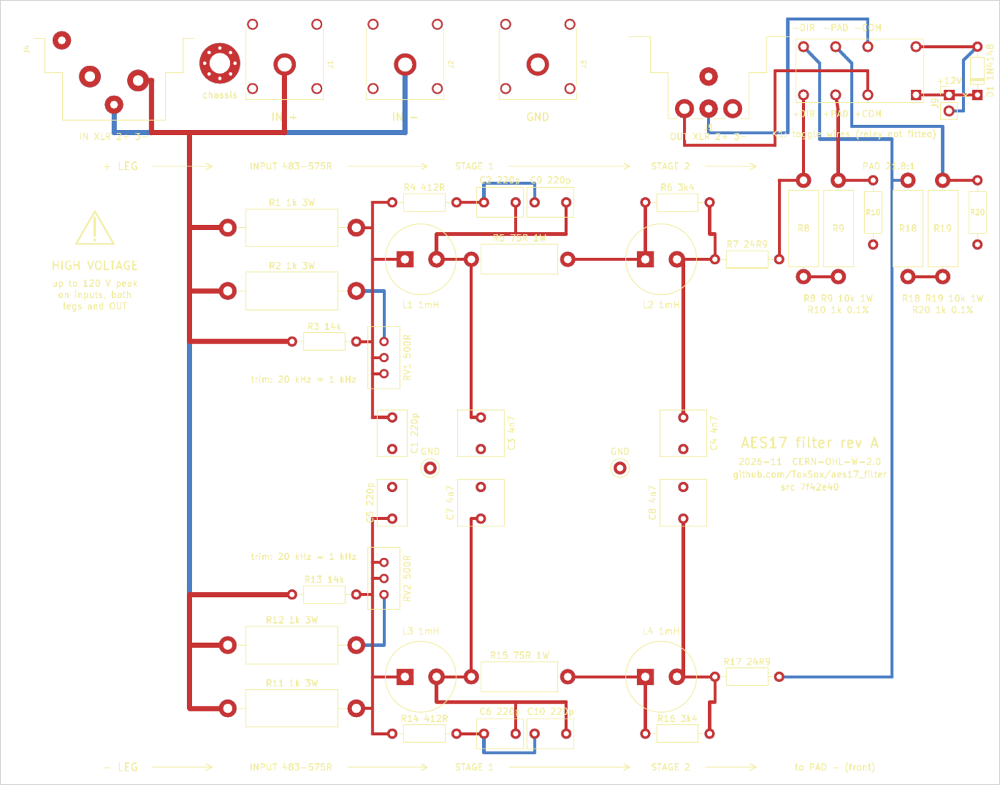
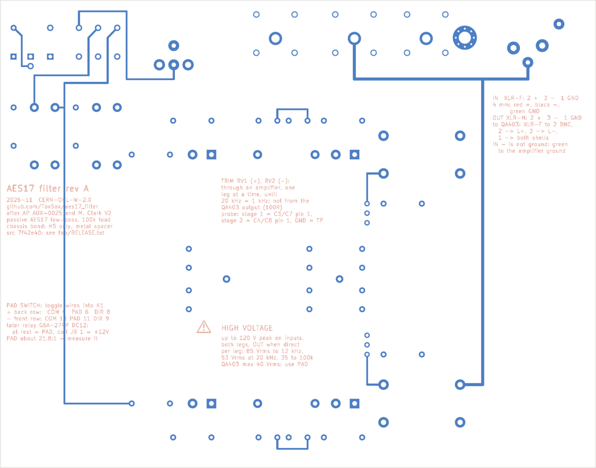

# AES17 filter board: files and how to order

The passive class-D measurement filter from [docs/design-review.md](../docs/design-review.md),
as a board. Everything here is generated from `design.py`; nothing was drawn by hand, so a
changed value or part is a changed line and a re-run.

| File | What it is |
|---|---|
| `design.py` | every part with value, footprint, LCSC number and note; every net |
| `make_pcb.py` | places and routes the board with KiCad 7's `pcbnew` module, fills the ground planes, runs the DRC; writes `aes17-filter.kicad_pcb` |
| `export.py` | writes `fab/`: the Gerber + drill zip, the JLCPCB bill of materials and placement file, a parts list with notes |
| `make_schematic.py` | draws `aes17-filter-schematic.svg/.png` (schemdraw) |
| `make_frontwall.py` | draws the front wall's drilling and the panel legend, `aes17-filter-frontwall.svg/.png` |
| `check_release.py` | checks that the board, the order files, the source hash and the DRC report belong together; exit code 0 = fit to order |
| `aes17-filter.kicad_pcb` | the board, for KiCad 7 or newer; there is no `.kicad_sch`, the schematic is the drawing |
| `fab/aes17-filter-gerbers.zip` | upload this to JLCPCB |
| `fab/aes17-filter-bom.csv` | upload this as the BOM (Comment, Designator, Footprint, LCSC Part #) |
| `fab/aes17-filter-cpl.csv` | upload this as the placement file (Designator, Mid X, Mid Y, Layer, Rotation) |
| `fab/aes17-filter-parts.csv` | the same parts with values and notes, for ordering anything elsewhere |
| `fab/aes17-filter-schematic.pdf`, `fab/aes17-filter-drc.txt` | the schematic and the DRC report of this release |
| `fab/RELEASE.txt` | title, revision, the source hash printed on the board, and the SHA-256 of every order file |





## The board

158 × 124 mm, four layers, 1.6 mm, in a **Hammond 1444-862** aluminium chassis (203 × 152 × 51 mm,
flat 1 mm walls, closed by the 1434-86 bottom plate). **Every connector is on the front long
edge** and comes through the chassis' front long wall, so the filter hangs with that wall towards
the operator, as the AUX-0025's front panel does. From the left, seen from the front: the female
XLR input (pin 2 +, pin 3 −, pin 1 and shell ground), red and black 4 mm sockets at AP's
19.05 mm for a dual banana plug, the green common, the male XLR output (pin 2 +, pin 3 −), and
the pad toggle, mounted high in the wall straight above the switch. The QA403 is fed through a
self-made lead, XLR female to two BNC males. The first 24 mm behind the front edge are the
connector strip with the switch and the pad block at its right-hand end; the filter is the
100 mm band behind it, the two legs mirror images about its centre line. Layers 2 and 3 are
whole ground planes, broken only by the holes; every track is on layer 1 or 4. The board stands
on five M3 spacers on the bottom plate; the XLRs are screwed to the wall, the Cliff sockets held
by the board alone (they have no panel retention; the wall just has a clearance hole for the
Ø11 barrel). The DRC in KiCad 7 reports no errors and no unconnected nets at 0.8 mm clearance;
the warnings are silkscreen over pads and the footprints not being from a library table.

### Layout rules it follows

The board was gone over once more with the usual rules for audio layout. What they changed:

- **Whole ground planes.** Layers 2 and 3 carry nothing but ground. The earlier layout ran the
  two filter outputs on layer 3, which cut slots into the plane right under the output tracks
  on layer 4; those tracks lost their return path exactly where the analyzer's signal ran.
- **Clearance for the voltage.** Everything from the input up to OUT (in the direct position)
  carries the amplifier's voltage: 120 V peak at the rating of 85 Vrms per leg. IPC-2221B asks 0.8 mm
  between bare pads at 101-300 V; the board had 0.3 mm and now keeps 0.8 mm everywhere. The
  male XLR's lands on pins 1 and 2 are 3.0 mm instead of Neutrik's 3.4 mm for the same reason.
- **The pad and the switch at the output connector.** The two pads now stand side by side right
  behind the switch, identical copies, so they share a temperature and their ratios track. The
  toggle sits in the wall straight above K1's footprint, and its six wires drop about 15 mm into
  K1's contact holes; before, they ran 75 mm through the box to a header in the middle of the
  board. The separate 2 × 3 header J8 is gone: it hung a stub on the output and is not needed
  while K1's holes take the wires.
- **Long runs only at low impedance.** The negative leg ends at the back of the board, so one
  track has to come forward. It is now the filter output F_N, behind 24.9 Ω, the lowest
  impedance in the chain, and it runs alone through empty board. Before, the output pair came
  back to the middle of the board, and in the pad position OUT sits behind 950 Ω, where 1 pF of
  stray capacitance from the input side is already −50 dB at 500 kHz.
- **Pairs kept together.** IN+ and IN− run on top of each other (layer 1 over layer 4) from the
  connectors to where the legs part; OUT+ and OUT− run side by side, 2 mm apart, from K1 to the
  XLR. Before, the negative input went round the board's left edge and the two outputs ran 10 mm
  apart.
- **More distance between the stages.** The second coil of each leg is 38 mm from the first
  instead of 32 mm. Coupling between two drum cores falls with the cube of the distance, so
  L1 → L2, the one path that bypasses the filter, is about 4.5 dB weaker on top of the shielding.
- **One chassis bond, where the cables come in.** H5 is a plated hole on ground in the
  connector strip, next to the input XLR: with a metal spacer it ties the ground plane to the
  bottom plate and so to the chassis, and cable shield currents go to the chassis there instead
  of crossing the filter. The other four holes are plain.

What stayed as it was, because it was right: the two legs mirror images, so each sees the same
parasitics; the shunt capacitors' grounds meeting in the middle of the board, so the
differential residue current takes a short path between the legs; polypropylene capacitors and
metal-film resistors throughout; the hot 3 W input resistors well away from the polypropylene
capacitors (FKP2 is rated to 100 °C).

### Silkscreen

Top: every part with its name and value in the notation that survives a lost dot (R1 1k 3W,
R7 24R9, C3 4n7, L1 1mH), the pad block with a legend under each pad, each leg's signal flow
along its outer edge (input network, stage 1, stage 2, pad), a high-voltage warning beside the
inputs, K1's six holes labelled for the toggle wires, +12V at the coil header, and the title
"AES17 filter rev A" with date, licence and source location (the CERN-OHL-W asks for the source
location on the product where practicable). Bottom, readable from below: a crib sheet with the
connector pin-outs and the QA403 lead, the switch wiring and the relay, the trim procedure and
the voltage limits. Both sides carry "src" and the source hash, the first seven digits of the
SHA-256 of `design.py` and `make_pcb.py`, the same as in `fab/RELEASE.txt`. Two ground loops,
TP1 and TP2, sit between the stages for a scope probe's ground spring. Title, revision and date
are three constants at the top of `design.py`.

## Ordering at JLCPCB

0. **Check the release.** `python3 hardware/check_release.py` must end with "fit to order".
   Order from a commit, not from a working copy, and keep its source hash (in `fab/RELEASE.txt`
   and printed on both sides of the board, "src ...") with the order: a board in the hand is
   then matched to its files without guessing.
1. **PCB.** Upload `fab/aes17-filter-gerbers.zip`. Four layers, 1.6 mm, any colour, 1 oz copper,
   HASL or ENIG as you like, five pieces (the minimum). The stack-up JLCPCB offers for four
   layers (JLC04161H-7628 or similar) is fine; nothing here depends on impedance.
2. **Assembly.** Tick assembly, **two boards**, top side only, Economic. Upload
   `fab/aes17-filter-bom.csv` and `fab/aes17-filter-cpl.csv`. All parts are through-hole;
   JLCPCB hand-solders those ($3.58 per order plus $0.0164 per joint, one extra day).
3. **Parts review.** In the parts page every line with an LCSC number resolves on its own,
   including the coils: the Würth WE-TIS 7447471102 is JLCPCB part **C1331105** (not in LCSC's
   own shop, which is why the first search missed it; JLCPCB lists it as ±20 %, the datasheet
   says ±10 %, and the trimmer covers either). It is a pre-order part like the WIMA capacitors;
   JLCPCB's global-sourcing quote of 1 November 2026, should it be needed instead, was Digi-Key
   3.01 € (339 in stock, 8-14 business days), RS 2.74 € at five, Element14 2.97 €, Mouser 3.37 €.
   The unshielded Würth 7447480102, C1331132, fits the same footprint and is the fallback. The
   BOM file is plain ASCII on purpose: JLCPCB's import reads "Würth" as "W眉rth". Four more lines are **pre-order** (both WIMA capacitors, the Cliff sockets): JLCPCB
   buys them after payment, quotes the final price within 48 hours, and they take nine to
   twenty business days to arrive; connectors carry a $20 inspection fee per type, so the three
   Cliff colours cost $60 in inspection alone. The cheaper route for the Cliff sockets is to
   **leave them out of the assembly** (delete J1, J2, J3 from the BOM upload), buy them at
   Digi-Key (6.80 € each against $11-12 pre-order) and solder the three per board yourself - one
   pin and four pegs each.
4. **Every line has an LCSC number.** Two were found without a stock figure visible from
   here: the pad's 10 kΩ 1 W resistors (R8, R9, R18, R19) are the UNI-ROYAL MFR01SF1002A10,
   C58714, with the Yageo MFR1WSFTE52-10K, C172916, as the alternative if the first shows no
   stock in the BOM tool; both fit the 15.24 mm footprint.
5. **Do not place K1.** It is marked "do not place" in the files and is not in the BOM; its
   holes take the toggle's wires until the matrix controller drives a relay there.
6. After the order: the five boards arrive, two assembled. Nothing else is needed from JLCPCB.

### What JLCPCB's BOM tool quoted on 1 November 2026

For an assembly of five boards (quantities include JLCPCB's attrition allowance), in euros:

| Line | Qty | Total | Per piece | Status |
|---|---|---|---|---|
| TE 5227161-7 BNC (C591726) | 20 | 99.63 | 4.98 | in stock; no longer on the board - the XLR output replaced the BNCs |
| Cliff FCR7350R / B / G (C6041087 / C6555263 / C6041085) | 5 each | 58.13 / 58.13 / 50.32 | 11.6 / 11.6 / 10.1 | **shortage: pre-order**, plus the connector inspection fee per type |
| WIMA 220 pF 630 V ±2.5 % (C5742108) | 30 | 7.19 | 0.24 | shortage: pre-order |
| WIMA 4.7 nF 250 V (C20412818) | 25 | 10.70 | 0.43 | shortage: pre-order |
| Bourns 3296W-1-501LF (C69564) | 10 | 6.75 | 0.67 | in stock |
| TE YR1B1K0CC 0.1 % (C1364308) | 10 | 3.57 | 0.36 | in stock |
| UNI-ROYAL 1 kΩ 3 W (C58750) | 21 | 1.04 | 0.05 | in stock |
| UNI-ROYAL 10 kΩ 1 W (C58714) | 21 | 0.51 | 0.02 | in stock |
| 75 Ω 1 W (C160685) | 11 | 0.47 | 0.04 | in stock |
| 14 k, 412, 3.4 k, 24.9 (C127223, C3558411, C3517441, C3542579) | 11-15 each | 0.15 / 0.06 / 0.17 / 0.36 | 0.01-0.02 | in stock |
| 1N4148 (C258182), headers (C65114, C492401) | 10 / 5 / 5 | 0.26 / 0.20 / 0.08 | | in stock; the 2 × 3 header C65114 has since left the board |
| Würth 7447471102 coils | 20 | about 58 | 2.9 | unmatched by design: "Vorbestellen" → global sourcing |

About 356 € of parts for five assembled boards, 71 € per board, of which the three Cliff sockets
are 33 € and the four BNCs 20 € (the BNCs have since left the board). The Cliff sockets are the line to take out of the assembly:
pre-order at 11 € each plus the inspection fee, against 6.80 € at Digi-Key for a part with one
pin and four pegs to solder. Assembling two boards instead of five brings the parts to about
140 € plus the coils.

## What is not on the board

| Qty for two boards | Part | Where |
|---|---|---|
| 8 | M3 × 8 screws and nuts for the XLR flanges | any |
| 1 | a cable from the amplifier's terminals to a male XLR plug (pin 2 +, pin 3 −), or dual banana leads - the same cable then feeds an AUX-0025 | self-made |
| 2 | an XLR-female-to-two-BNC-male lead to the QA403: pin 2 to L+ centre, pin 3 to L− centre, pin 1 to both BNC shells; about 30 cm, both legs equal | self-made (Neutrik NC3FXX, two BNC plugs, two pieces of RG58 or RG174) |
| 2 | DPDT toggle, ON-ON, non-shorting, panel mount, 1/4 in bushing, solder lugs; best with a locking lever and gold contacts | APEM 5000 or C&K 7000 series with those options; a plain Knitter MTA 206 works |
| 2 | insulating sheet, 0.25 mm polyester or fish paper, cut to the bottom plate around the spacers | any |
| 2 | Hammond 1444-862 chassis and 1434-86 bottom plate | Digi-Key, Mouser, Reichelt; about 20 € and 11 € |
| 10 | M3 spacers, 10 mm, and M3 screws, for the board on the bottom plate; the one under H5 metal, with a star washer on the bottom plate | any |
| 6 | Cliff FCR7350 R, B, G if bought outside JLCPCB | Digi-Key, Farnell |
| | wire for the toggle: six pieces of about 25 mm, 0.25 mm² stranded, into K1's holes | |

## Building the two boards

1. Check the assembled board against `fab/aes17-filter-parts.csv`; measure the four coils if
   an LCR meter is at hand (not required, the trimmer takes care of their spread).
2. Drill the front wall after `aes17-filter-frontwall.png`; the hole table is at the end of this
   file. Easiest and safest: drill the four spacer holes in the bottom plate, stand the board on
   its spacers, put the chassis over it, and mark the connector centres through from inside.
3. Fit the board on the bottom plate, put the chassis over it, screw the XLR flanges to the
   wall, fit the toggle.
4. Wire the toggle into K1's six holes, straight below it. Pole A to the back row, whose holes are
   labelled +COM, +PAD, +DIR: its common lug to +COM (K1 pin 4, OUT+), the outer lugs to +PAD
   (pin 6) and +DIR (pin 8). Pole B the same to the front row, -COM, -PAD, -DIR (pins 13, 11, 9). Check with an ohmmeter
   between the output XLR's pin 2 (then pin 3) and pin 1, inputs open: about 1.0 kΩ in the pad
   position (the 1 kΩ leg of the pad), about 21 kΩ in the direct one (the whole pad, seen from
   its top). Mark the positions on the front.
5. Lay the insulating sheet on the bottom plate before the board goes in; use a metal spacer
   under H5 and plastic or metal under the rest (only H5 is plated).
6. Work through the [verification plan](../docs/design-review.md#verification-what-makes-it-a-reference):
   trim both legs through an amplifier until 20 kHz equals 1 kHz, the pad ratio over frequency
   into the measurement software's probe settings, then the ferrite, ground, heat and stop-band tests before the
   filter is used as a reference. Connect the green socket to the amplifier's ground in use.

## Regenerating

```
python3 hardware/make_pcb.py        # board + DRC report (needs KiCad 7 with pcbnew for Python)
python3 hardware/make_schematic.py  # schematic, also fab/…-schematic.pdf (pip install schemdraw)
python3 hardware/export.py          # fab/ and fab/RELEASE.txt (needs kicad-cli; after the schematic)
python3 hardware/make_frontwall.py  # front wall drilling (matplotlib)
python3 hardware/check_release.py   # do the files belong together?
```

Run `make_schematic.py` before `export.py`: the schematic PDF is one of the files the release
manifest hashes.

## Front wall holes

See `aes17-filter-frontwall.png`; the table below is printed by `make_frontwall.py`. In blue the
drawing also carries the legend for the panel: the rating per leg at the inputs, "GND to the
amplifier ground", the switch positions and DIRECT's 40 Vrms limit. The wall is
the front long wall of the Hammond 1444-862, seen from outside, x from its left end, y from its
bottom edge (which rests on the 1434-86 bottom plate).

| Hole | Ø mm | x | y |
|---|---|---|---|
| XLR IN (female), Neutrik NC3FAAH2 | 22.5 | 40.6 | 24.1 |
| its two M3 screws, upper left and lower right | 3.2 | 30.7 / 50.5 | 34.0 / 14.2 |
| 4 mm IN + (red) | 11.5 | 67.6 | 17.9 |
| 4 mm IN − (black), 19.05 mm from the red one | 11.5 | 86.6 | 17.9 |
| 4 mm GND (green) | 11.5 | 107.6 | 17.9 |
| XLR OUT (male), Neutrik NC3MAAH | 22.5 | 134.6 | 24.1 |
| its two M3 screws, upper left and lower right | 3.2 | 124.7 / 144.5 | 34.0 / 14.2 |
| pad toggle, 1/4 in bushing | 6.4 | 158.6 | 35.6 |

The heights assume the board on **10 mm M3 spacers** on the bottom plate, so its top surface is
11.6 mm above the wall's bottom edge; the Cliff socket axis is 6.3 mm above the board, the XLR
axis 12.5 mm, the toggle's 24 mm (high enough to clear a relay fitted below it later). **The XLR axis height is read off Neutrik's front view, not a dimensioned value:
fit the board on its spacers, hold the undrilled wall against the connector fronts and mark
through before drilling.** The board's front edge sits 3.3 mm behind the wall's inner face, so
the XLR flanges and the shoulders of the 4 mm sockets lie against the wall. Cliff does not
specify a panel hole for the S16N-PC; Ø11.5 clears its Ø11.0 barrel. Neutrik asks for a hole of
at least Ø22 and two Ø3.2 screw holes 19.8 mm apart on the diagonal.
